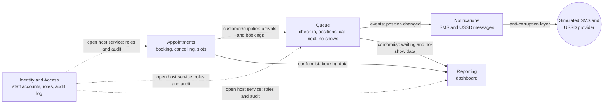

# Requirements: District Clinic Appointment & Queue System (M1)

Roles note: clinic manager and clinic administrator are separate roles. The manager sees reports; the administrator manages accounts, roles and the audit log. Keeping them apart means the person who can read the audit log is not the person whose scheduling decisions it evidences.

QA note: the acceptance criteria below incorporate the QA review of the first draft. Scenarios were revised to name their test data, state expected values, and verify the underlying state change rather than only the message shown to the user.

## 1. Stakeholders

| Stakeholder | Role and interest |
| --- | --- |
| Patients | Book appointments, see their queue position by SMS, avoid long waits |
| Receptionists / front desk staff | Register patients, manage the daily appointment list, handle walk-ins |
| Nurses | See who is waiting and in what order |
| Doctors / clinicians | See their daily list and patient flow |
| Clinic manager | Monitors no-shows and waiting times to plan staffing and scheduling. Sees reports only |
| Clinic administrator | Creates staff accounts, assigns roles and reviews the audit log. Does not open patient records in the course of care |
| District health office / health authority | Interested in clinic performance and compliance with health regulations |
| Data protection regulator | Cares about Act 843 compliance for patient data |
| SMS / USSD provider (simulated) | External service the system depends on for notifications |
| Development team and lecturer | Build and assess the system |

## 2. User stories (patient-facing)

Each story follows the INVEST form and has Gherkin acceptance criteria, including at least one failure path. Staff-facing stories are in section 3.

### US-01 Book an appointment on the web

As a patient, I want to book an appointment online for a clinic and time slot, so that I do not have to travel to the clinic just to get a slot.

```gherkin
Scenario: Patient books an available slot
  Given the clinic has an available appointment slot for the selected department on Thursday at 09:00
  And the patient has provided all required booking details
  When the patient selects the available slot and confirms the booking
  Then the appointment is saved successfully
  And a unique booking reference is generated and displayed to the patient
  And the booking reference can be used to retrieve the saved appointment

Scenario: Patient tries to book a slot that has already been taken
  Given an appointment slot is available
  And another patient successfully books that slot
  When a second patient attempts to book the same slot
  Then the system rejects the second booking
  And the second patient is not assigned the occupied slot
  And the system displays other available appointment slots
```

### US-02 Book an appointment through a USSD-style menu

As a patient without a smartphone, I want to book through a simple phone menu, so that I can use the clinic service without internet access.

```gherkin
Scenario: Patient completes a booking through the USSD-style menu
  Given the patient has opened the USSD-style booking menu
  And an appointment slot is available for the selected clinic and department
  When the patient follows the menu steps and confirms the appointment
  Then the appointment is saved successfully
  And a confirmation SMS is sent to the patient's phone number
  And the SMS contains the appointment details and a unique booking reference

Scenario: Patient enters an invalid menu option
  Given the patient has selected a clinic and is on the appointment selection step
  And the menu displays options 1, 2 and 3
  When the patient enters option 5
  Then the menu displays an invalid option error message
  And the appointment selection step is displayed again
  And the previously selected clinic is retained
```

### US-03 Cancel or reschedule an appointment

As a patient, I want to cancel or reschedule my appointment, so that the slot can be used by someone else if I cannot attend.

```gherkin
Scenario: Patient cancels an upcoming appointment
  Given a patient has a confirmed appointment scheduled for Thursday at 09:00
  And the appointment is more than two hours away
  And the patient has the correct booking reference
  When the patient submits a cancellation request using the booking reference
  Then the appointment status is updated to cancelled
  And the appointment slot becomes available for another patient to book
  And the patient receives a cancellation confirmation

Scenario: Patient tries to cancel with a wrong booking reference
  Given no appointment exists with booking reference "ADC-9999"
  And another patient's appointment is confirmed and unchanged
  When the patient submits a cancellation request using booking reference "ADC-9999"
  Then the system displays an appointment not found message
  And no appointment is cancelled or modified
  And the other patient's appointment remains confirmed

Scenario: Patient successfully reschedules an appointment
  Given a patient has a confirmed appointment for Thursday at 09:00
  And another appointment slot is available for Friday at 10:00
  When the patient reschedules using the booking reference
  And selects Friday at 10:00
  Then the original appointment is updated
  And the Friday at 10:00 slot is assigned to the patient
  And the original Thursday at 09:00 slot becomes available
  And the patient receives a rescheduling confirmation
```

Open: whether the booking reference stays the same on reschedule or a new one is generated (see section 7).

### US-04 Receive my queue position by SMS

As a patient who has arrived at the clinic, I want to receive my queue position by SMS, so that I know how long I will wait.

```gherkin
Scenario: Patient is checked in and gets a queue position
  Given the patient has a confirmed appointment for today
  And the patient has a registered phone number
  When the receptionist checks the patient in
  Then the patient is added to today's queue
  And the patient receives an SMS showing their queue position

Scenario: SMS cannot be delivered
  Given the simulated SMS gateway is unavailable
  When a queue position message is due
  Then the queue operation succeeds
  And the system retries sending the message at least 3 times within 10 minutes
  And the failed delivery is recorded
```

The retry numbers come from NFR-06. Open: what the failure record must contain and which log holds it.

### US-05 Get updates as my turn approaches

As a patient waiting for a consultation, I want updates when my position changes or my turn is near, so that I can be ready without staying in the waiting room.

```gherkin
Scenario: Patient is notified that their turn is near
  Given the patient is third in today's queue
  When the two patients ahead of them are called in
  Then the patient receives an SMS notification
  And the SMS informs the patient that their turn is near

Scenario: A patient ahead leaves the queue
  Given the patient is fifth in today's queue
  When a patient ahead of them is marked as a no-show
  Then the patient's queue position is updated to fourth
  And the patient receives an SMS showing the new position
```

### US-06 Check my queue position on demand

As a patient, I want to check my current queue position using my booking reference, so that I can see it without waiting for a message.

```gherkin
Scenario: Patient checks their position
  Given the patient is third in today's queue
  And the patient has a valid booking reference
  When the patient enters their booking reference
  Then the system displays their current queue position as 3
  And displays the estimated waiting time

Scenario: Booking reference does not belong to today's queue
  Given the booking reference belongs to a confirmed future appointment
  When the patient enters the booking reference to check their queue position
  Then the system informs the patient that the queue has not started for that appointment
  And the future appointment remains unchanged
  And the patient is not added to today's queue
```

Open: how the estimated waiting time is calculated. Until that is agreed, the second step can only assert that a value is shown, not which value.

## 3. User stories (staff-facing)

### US-07 Register a walk-in patient

As a receptionist, I want to register a patient who arrives without an appointment, so that they join today's queue fairly.

```gherkin
Scenario: Receptionist registers a walk-in
  Given the receptionist is logged in
  And there are 3 patients waiting in today's queue
  When the receptionist enters a walk-in patient's name and phone number
  Then the patient is added as the fourth patient in today's queue
  And an SMS showing position 4 is sent to the patient's phone number

Scenario: Required details are missing
  Given the receptionist is registering a walk-in
  When they submit the form without a phone number
  Then the system displays a message that the phone number is required
  And the patient is not added to today's queue
```

A missing name is not covered here; add a separate scenario if the team wants it tested.

### US-08 Check in a booked patient

As a receptionist, I want to check in a patient who has a booking, so that they enter the queue in the right order.

```gherkin
Scenario: Receptionist checks in a patient with a valid booking
  Given the patient has an appointment today at 09:00
  And the patient has a valid booking reference
  When the receptionist enters the booking reference
  Then the patient is marked as arrived
  And the patient is placed in the queue according to their appointment time

Scenario: Checked-in patients are queued according to appointment time
  Given Patient A has a confirmed appointment at 09:00
  And Patient B has a confirmed appointment at 10:00
  And Patient B checks in before Patient A
  When Patient A checks in
  Then Patient A is placed first in the queue
  And Patient B is placed second in the queue

Scenario: Booking reference belongs to another day
  Given the booking reference belongs to an appointment on another day
  When the receptionist tries to check the patient in
  Then the system shows that no appointment was found for today
  And the patient is not added to today's queue
  And the system offers to register the patient as a walk-in
```

The second scenario exists because ordering by appointment time rather than arrival order is only provable with two patients. A reference that does not exist at all is a separate case from one belonging to another day; see section 7.

### US-09 Call the next patient

As a nurse, I want to call the next patient in the queue, so that patients are seen in order and everyone's position updates.

```gherkin
Scenario: Nurse calls the next patient
  Given 3 patients are waiting in the queue
  When the nurse selects "Call next"
  Then the first patient is marked as in consultation
  And the remaining waiting patients' positions are recalculated
  And patients who are no longer waiting are not assigned waiting positions

Scenario: Queue is empty
  Given no patients are waiting in the queue
  When the nurse selects "Call next"
  Then the system displays a message that the queue is empty
  And no patient status or queue position changes
```

"Positions are recalculated" replaces "reduced by one", which would otherwise have applied to patients already in consultation, completed or marked no-show.

### US-10 Mark a patient as a no-show

As a receptionist, I want to mark a patient who did not arrive as a no-show, so that the queue moves on and the clinic can track missed appointments.

```gherkin
Scenario: Receptionist marks an eligible appointment as a no-show
  Given a patient has a confirmed appointment
  And the patient has not checked in
  And the allowed waiting time for the appointment has passed
  When the receptionist marks the appointment as a no-show
  Then the appointment status is updated to no-show
  And the patient is removed from the active queue
  And the action is recorded in the audit log

Scenario: Receptionist cannot mark an already checked-in patient as a no-show
  Given a patient has already been checked in
  And the patient is in the active queue
  When the receptionist attempts to mark the patient as a no-show
  Then the system blocks the action
  And displays a message that the patient has already checked in
  And the patient's status remains unchanged
```

Open: the allowed waiting time and when its timer starts, and whether marking a no-show also releases the slot. Both are needed before this is final.

### US-11 View no-shows and waiting times

As a clinic manager, I want a dashboard of no-shows and waiting times, so that I can plan staffing and reduce missed appointments.

```gherkin
Scenario: Manager views dashboard statistics for a selected date range
  Given the manager is logged in
  And appointment and queue records exist for the selected date range
  When the manager selects the date range
  Then the dashboard displays the total number of no-shows
  And displays the average waiting time
  And displays the no-show rate
  And the displayed statistics match the underlying records

Scenario: Manager views dashboard for a date range with no appointments
  Given the manager is logged in
  And no appointment records exist for the selected date range
  When the manager opens the dashboard for that date range
  Then the system displays a message indicating that no data is available
  And no appointment statistics are displayed for that range
  And no misleading charts are displayed
```

Open: the full list of dashboard metrics, and the no-show-rate formula including its denominator.

### US-12 Manage staff accounts and roles

As a clinic administrator, I want to create staff accounts and assign roles, so that each person can only see and do what their job requires.

```gherkin
Scenario: Administrator creates a staff account with a role
  Given the clinic administrator is logged in
  When the administrator creates a staff account with valid details
  And assigns the Receptionist role to the account
  Then the staff account is created successfully
  And the new receptionist can log in
  And the receptionist can access permitted receptionist functions
  And the receptionist cannot access functions restricted to other roles

Scenario: Receptionist is denied access to staff account management
  Given a receptionist is logged in
  When the receptionist attempts to open the staff account management page
  Then the system denies access
  And displays an access-denied message
  And records the unauthorized access attempt in the audit log
```

These two scenarios are not sufficient on their own to satisfy NFR-04, which requires automated authorisation tests across every role-restricted endpoint. See section 7.

### US-13 Review the audit log

As a clinic administrator, I want to review who accessed or changed patient records, so that we can show Act 843 compliance and investigate misuse.

```gherkin
Scenario: Administrator reviews patient record activity
  Given a patient record has been viewed and updated by a staff member
  And the administrator is logged in
  When the administrator opens the audit log
  Then the audit log displays an entry for viewing the patient record
  And displays an entry for updating the patient record
  And each entry shows the staff member who performed the action
  And each entry shows the action performed
  And each entry identifies the affected patient record
  And each entry shows the date and time of the action

Scenario: Nurse is denied access to the audit log
  Given a nurse is logged in
  When the nurse attempts to open the audit log
  Then the system denies access
  And displays an access-denied message
  And the nurse cannot view any audit-log entries
```

The one-second audit-entry requirement in NFR-05 is verified as a separate timing check, not in these scenarios.

With US-01 to US-13 this gives 13 stories, one more than the minimum of 12.

## 4. Non-functional requirements (at least 6, measurable, ISO 25010)

Each one names a quality, a metric and threshold, the conditions, and how it will be verified.

| ID | ISO 25010 quality | Requirement | Verification |
| --- | --- | --- | --- |
| NFR-01 | Reliability (availability) | Booking, check-in and queue functions are available at least 99.5% of the time during clinic hours (07:00 to 18:00, Monday to Friday), measured per calendar month. | Uptime monitoring on staging using the /health endpoint; availability calculated from the monitoring record. |
| NFR-02 | Performance efficiency (time behaviour) | 95% of check-in and call-next requests complete within 2 seconds with 20 concurrent staff users. | Load test run against staging; result recorded in the test report. |
| NFR-03 | Performance efficiency (timeliness of SMS) | 95% of queue-position messages are handed to the SMS gateway (simulated) within 30 seconds of the queue change. | Timestamps in the audit log compared in an integration test using the simulated gateway. |
| NFR-04 | Security (access control) | Every staff endpoint rejects users without the required role with an access-denied response; 100% of role-restricted endpoints are covered by automated authorisation tests. | Authorisation tests in the CI pipeline; fails the build if an endpoint has no test. |
| NFR-05 | Security (accountability, Act 843) | Every view or change of a patient record creates an audit entry (who, what, which record, when) within 1 second; 100% of record endpoints are covered. | Automated tests that call each record endpoint and check the audit entry. |
| NFR-06 | Reliability (fault tolerance) | When the SMS gateway is unavailable, 100% of queue operations still succeed, and undelivered messages are retried at least 3 times within 10 minutes. | Integration test that makes the simulated gateway fail on purpose. |
| NFR-07 | Interaction capability (usability) | At least 90% of first-time receptionists can register a walk-in in under 60 seconds after a 5-minute orientation, tested with at least 5 users. | Usability test with classmates acting as receptionists; results recorded. |
| NFR-08 | Performance efficiency (low bandwidth) | The patient booking page loads in under 3 seconds on a throttled slow-3G connection, with total page size under 500 KB. | Browser developer-tools throttling or Lighthouse run on staging. |
| NFR-09 | Maintainability (testability) | Domain code (appointments and queue logic) has at least 70% branch coverage, enforced as a gate in CI. | Coverage report produced by the CI pipeline. |

## 5. Prioritised backlog (WSJF and MoSCoW)

**WSJF** = (business value + time criticality + risk reduction or opportunity enablement) divided by job size. Scores use a relative scale of 1, 2, 3, 5, 8, 13, and are proposals for the team to agree on. Stories are listed in WSJF order.

| Story | Business value | Time criticality | Risk reduction | Job size | WSJF | MoSCoW |
| --- | --- | --- | --- | --- | --- | --- |
| US-08 Check in a booked patient | 8 | 8 | 5 | 3 | (8+8+5)/3 = 7.0 | Must |
| US-09 Call the next patient | 8 | 8 | 5 | 3 | (8+8+5)/3 = 7.0 | Must |
| US-12 Manage staff accounts and roles | 8 | 8 | 13 | 5 | (8+8+13)/5 = 5.8 | Must |
| US-07 Register a walk-in patient | 8 | 5 | 3 | 3 | (8+5+3)/3 = 5.3 | Must |
| US-01 Book an appointment on the web | 13 | 8 | 5 | 5 | (13+8+5)/5 = 5.2 | Must |
| US-03 Cancel or reschedule | 5 | 3 | 3 | 3 | (5+3+3)/3 = 3.7 | Should |
| US-10 Mark a no-show | 5 | 3 | 3 | 3 | (5+3+3)/3 = 3.7 | Must |
| US-04 Queue position by SMS | 8 | 5 | 5 | 5 | (8+5+5)/5 = 3.6 | Must |
| US-13 Review the audit log | 5 | 3 | 8 | 5 | (5+3+8)/5 = 3.2 | Should |
| US-06 Check position on demand | 3 | 2 | 2 | 3 | (3+2+2)/3 = 2.3 | Could |
| US-05 Updates as turn approaches | 5 | 3 | 3 | 5 | (5+3+3)/5 = 2.2 | Should |
| US-02 Book through USSD-style menu | 5 | 3 | 3 | 8 | (5+3+3)/8 = 1.4 | Could |
| US-11 View no-shows and waiting times | 5 | 2 | 3 | 8 | (5+2+3)/8 = 1.3 | Must |

**Why some MoSCoW ratings differ from the WSJF order**

- US-11 is a Must even though its WSJF is lowest, because the handbook lists the staff dashboard (no-shows and waiting times) as a minimum feature.
- US-04 is a Must because live SMS queue updates are a minimum feature.
- US-02 is a Could because the handbook allows booking by "web/USSD-style simulation", so the web booking in US-01 meets the requirement on its own.
- US-12 is a Must because role-based access is a named engineering challenge.
- US-13 is a Should for now. Writing audit entries is covered by NFR-05, and reviewing them on screen can follow.

**Won't have this semester:** a real SMS or USSD provider, and any real patient data (the handbook allows sandbox or simulated services only).

## 6. Context map

Five bounded contexts, with the relationships between them:



| Context | Responsibility | Relationships |
| --- | --- | --- |
| Appointments | Slots, bookings, cancellations and rescheduling | Supplies booking and check-in data to Queue; feeds Reporting |
| Queue | Check-in, positions, calling the next patient, no-shows | Receives bookings from Appointments; publishes position changes to Notifications; feeds Reporting |
| Notifications | Builds and sends SMS and USSD-style messages, with retries | Listens to Queue events; talks to the external provider through an adapter so provider details stay out of the other contexts |
| Identity and Access | Staff accounts, roles and the audit log | Provides roles and audit recording to all other contexts |
| Reporting | Dashboard of no-shows and waiting times | Reads data from Appointments and Queue without changing it |

## 7. Decisions raised by the QA review

The QA review left nine rules undefined. Each is decided below with its reasoning, so the team has something concrete to challenge. **These stand unless someone objects.** Raise an objection in the team group and we will change it; the reasoning is written out so the argument can be had properly rather than rediscovered later.

### D-01 — Grace period before a no-show

**Decided:** a patient may be marked as a no-show 30 minutes after their scheduled appointment time. The timer starts at the appointment time, not at the start of the clinic session.

Patients travel by shared transport and traffic is unpredictable, so a short grace period would punish people for things outside their control. Thirty minutes is forgiving without letting one absence stall the queue. The threshold is configurable per department.

### D-02 — What marking a no-show does

**Decided:** the appointment status becomes no-show, the patient is removed from the active queue, and the slot is released so it counts as free capacity for the rest of that day.

Both effects are needed. Removing the patient keeps the queue honest; releasing the slot means the day's capacity figures and any same-day reallocation reflect reality.

### D-03 — How the estimated wait is calculated

**Decided:** estimated wait = (number of patients ahead) × (rolling mean consultation time for that department today). Where fewer than five consultations have completed, a configured default of 12 minutes per consultation is used instead. The result is rounded to the nearest 5 minutes and shown as "about N minutes".

A rolling same-day mean adapts to how the clinic is actually running. Rounding matters: an estimate presented as "34 minutes" claims a precision the method does not have.

### D-04 — Dashboard metrics and the no-show rate

**Decided:** the dashboard shows total appointments split into booked and walk-in, no-show count, no-show rate, average waiting time, the longest day in the range, and SMS delivery rate.

**No-show rate = no-shows ÷ booked appointments.** Walk-ins are excluded from the denominator, because a walk-in cannot fail to attend an appointment they never made. Including them understates the rate and flatters the clinic.

### D-05 — Role-permission matrix

**Decided** as below. This is the matrix NFR-04's authorisation tests are written against.

| Function | Receptionist | Nurse | Manager | Administrator |
| --- | --- | --- | --- | --- |
| View today's queue | Yes | Yes | Read-only | No |
| Check in a booked patient | Yes | No | No | No |
| Register a walk-in | Yes | No | No | No |
| Call the next patient | No | Yes | No | No |
| Mark a consultation complete | No | Yes | No | No |
| Mark a no-show / undo | Yes | No | No | No |
| View a patient record | Yes | Yes | No | No |
| View reports | No | No | Yes | No |
| Create staff accounts, assign roles | No | No | No | Yes |
| View the audit log | No | No | No | Yes |

Two points a reviewer will ask about. The manager cannot open patient records, because nothing in planning staffing requires naming a patient. The administrator cannot either, which means the person who reads the audit log is not someone the audit log is likely to be about.

### D-06 — Failed SMS records

**Decided:** failed deliveries go to a separate notification log, not the audit log. Each record holds the message id, recipient number, message type, the queue event that triggered it, attempt number, timestamp per attempt, the gateway error returned, and the final state.

The audit log exists to answer who accessed patient data, which is an Act 843 question. Filling it with gateway timeouts makes that harder to review, and the two have different retention needs.

### D-07 — Reschedule and the booking reference

**Decided:** rescheduling keeps the original booking reference. The appointment record holds a history of its changes.

The patient has the reference written down or sitting in an SMS. Issuing a new one creates two references in circulation and a support call when the patient arrives quoting the old one.

### D-08 — Undo on a no-show

**Decided:** the patient is restored to the queue by the ordering rule in D-09, as if they had just checked in. A new audit entry records the undo; the original no-show entry is never removed.

"Original position" is undefined once other patients have been called. Re-applying the normal rule is one behaviour instead of two, and a patient wrongly marked absent keeps the place their appointment time earns them.

### D-09 — Where walk-ins sit in the queue

**Decided:** every queue entry sorts on one key. For a booked patient it is their appointment time; for a walk-in it is the time they registered. The queue is that list in ascending order.

This is a single rule that produces the behaviour both US-07 and US-08 describe. A walk-in joins behind everyone whose appointment time has already passed, which is what US-07's "added as the fourth patient" means in practice. A booked patient who checks in late still sits ahead of one with a later appointment, as US-08 requires. And a walk-in who arrives at 09:15 goes ahead of a 10:00 booking, which is correct: nobody should be seen before their own appointment time.

### Additional test coverage to add

- US-08: a booking reference that does not exist at all, as distinct from one belonging to another day.
- US-08: the same booking reference entered twice, which must not create duplicate queue entries.
- US-10: the Undo action, against the rule in D-08.
- NFR-04: automated authorisation tests across every cell of the D-05 matrix, not only the two scenarios in US-12.
- NFR-05: a timing check that audit entries are written within one second.

**Additional test coverage to add once the above are settled**

- US-08: a booking reference that does not exist at all, as distinct from one belonging to another day.
- US-08: the same booking reference entered twice, which must not create duplicate queue entries.
- US-10: the Undo action restoring a patient marked as a no-show.
- NFR-04: automated authorisation tests across every role-restricted endpoint, not only the two scenarios in US-12.
- NFR-05: a timing check that audit entries are written within one second.
