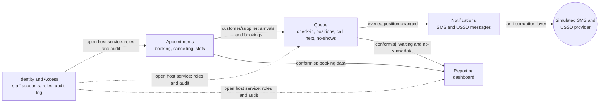

# Requirements: District Clinic Appointment & Queue System (M1)

Status: DRAFT for team review.

Roles note: clinic manager and clinic administrator are separate roles. The manager sees reports; the administrator manages accounts, roles and the audit log. Keeping them apart means the person who can read the audit log is not the person whose scheduling decisions it evidences.

## 1. Stakeholders

| Stakeholder | Role and interest |
| --- | --- |
| Patients | Book appointments, see their queue position by SMS, avoid long waits |
| Receptionists / front desk staff | Register patients, manage the daily appointment list, handle walk-ins |
| Nurses | See who is waiting and in what order |
| Doctors / clinicians | See their daily list and patient flow |
| Clinic manager | Monitors no-shows and waiting times to plan staffing and scheduling. Sees reports only |
| Clinic administrator | Creates staff accounts, assigns roles and reviews the audit log. Does not open patient records in the course of care |
| District health office / health authority | Interested in clinic performance and compliance with health regulations |
| Data protection regulator | Cares about Act 843 compliance for patient data |
| SMS / USSD provider (simulated) | External service the system depends on for notifications |
| Development team and lecturer | Build and assess the system |

## 2. User stories (patient-facing, first batch)

Each story follows the INVEST form and has Gherkin acceptance criteria, including at least one failure path. Staff-facing stories are in section 3.

### US-01 Book an appointment on the web

As a patient, I want to book an appointment online for a clinic and time slot, so that I do not have to travel to the clinic just to get a slot.

```gherkin
Scenario: Patient books an available slot
  Given a clinic has an open slot on Thursday at 09:00
  When the patient selects that slot and confirms their details
  Then the appointment is saved
  And the patient receives a confirmation with a booking reference

Scenario: Patient tries to book a slot that has just been taken
  Given a slot was booked by another patient a moment ago
  When the patient tries to confirm the same slot
  Then the booking is rejected
  And the patient is shown other available slots
```

### US-02 Book an appointment through a USSD-style menu

As a patient without a smartphone, I want to book through a simple phone menu, so that I can use the clinic service without internet access.

```gherkin
Scenario: Patient completes a booking through the menu
  Given the patient has opened the USSD-style booking menu
  When the patient chooses a clinic and an available time in the menu steps
  Then the appointment is saved
  And a confirmation SMS is sent to the patient's phone number

Scenario: Patient enters an invalid menu option
  Given the patient is on the clinic selection step
  When the patient enters an option that does not exist
  Then the menu shows an error message
  And repeats the same step without losing earlier choices
```

### US-03 Cancel or reschedule an appointment

As a patient, I want to cancel or reschedule my appointment, so that the slot can be used by someone else if I cannot attend.

```gherkin
Scenario: Patient cancels an upcoming appointment
  Given the patient has an appointment that is more than two hours away
  When the patient cancels it using the booking reference
  Then the slot becomes available again
  And the patient receives a cancellation confirmation

Scenario: Patient tries to cancel with a wrong booking reference
  Given no appointment matches the reference entered
  When the patient tries to cancel
  Then the system shows that the appointment was not found
  And no appointment is changed
```

### US-04 Receive my queue position by SMS

As a patient who has arrived at the clinic, I want to receive my queue position by SMS, so that I know how long I will wait.

```gherkin
Scenario: Patient is checked in and gets a queue position
  Given the patient has a booked appointment today
  When the receptionist checks the patient in
  Then the patient receives an SMS with their queue position

Scenario: SMS cannot be delivered
  Given the SMS service is unavailable
  When a queue position message is due
  Then the message is retried later
  And the failure is recorded in the audit log
```

### US-05 Get updates as my turn approaches

As a patient waiting for a consultation, I want updates when my position changes or my turn is near, so that I can be ready without staying in the waiting room.

```gherkin
Scenario: Patient is notified that their turn is near
  Given the patient is third in the queue
  When two patients ahead of them are called in
  Then the patient receives an SMS saying their turn is near

Scenario: A patient ahead leaves the queue
  Given the patient is fifth in the queue
  When a patient ahead of them is marked as a no-show
  Then the patient's position is updated
  And the patient receives the new position by SMS
```

### US-06 Check my queue position on demand

As a patient, I want to check my current queue position using my booking reference, so that I can see it without waiting for a message.

```gherkin
Scenario: Patient checks their position
  Given the patient is in today's queue
  When the patient enters their booking reference
  Then the current position and estimated wait are shown

Scenario: Booking reference does not belong to today's queue
  Given the booking reference belongs to a future appointment
  When the patient asks for the queue position
  Then the system explains that the queue has not started for that appointment
```

## 3. User stories (staff-facing)

### US-07 Register a walk-in patient

As a receptionist, I want to register a patient who arrives without an appointment, so that they join today's queue fairly.

```gherkin
Scenario: Receptionist registers a walk-in
  Given the receptionist is logged in
  When they enter the walk-in patient's name and phone number
  Then the patient is added to the end of today's queue
  And the patient receives their queue position by SMS

Scenario: Required details are missing
  Given the receptionist is registering a walk-in
  When they submit the form without a phone number
  Then the system shows which field is missing
  And the patient is not added to the queue
```

### US-08 Check in a booked patient

As a receptionist, I want to check in a patient who has a booking, so that they enter the queue in the right order.

```gherkin
Scenario: Receptionist checks in a patient with a valid booking
  Given the patient has an appointment today
  When the receptionist enters the booking reference
  Then the patient is marked as arrived
  And the patient is placed in the queue by appointment time

Scenario: Booking reference is not valid for today
  Given the booking reference belongs to another day or does not exist
  When the receptionist tries to check the patient in
  Then the system shows that no appointment was found for today
  And offers to register the patient as a walk-in
```

### US-09 Call the next patient

As a nurse, I want to call the next patient in the queue, so that patients are seen in order and everyone's position updates.

```gherkin
Scenario: Nurse calls the next patient
  Given at least one patient is waiting
  When the nurse selects "Call next"
  Then the first patient in the queue is marked as in consultation
  And every other patient's position is reduced by one

Scenario: Queue is empty
  Given no patients are waiting
  When the nurse selects "Call next"
  Then the system shows that the queue is empty
  And no status changes are made
```

### US-10 Mark a patient as a no-show

As a receptionist, I want to mark a patient who did not arrive as a no-show, so that the queue moves on and the clinic can track missed appointments.

```gherkin
Scenario: Receptionist marks a no-show
  Given a patient has not arrived within the allowed waiting time
  When the receptionist marks the appointment as a no-show
  Then the appointment is recorded as a no-show
  And the slot is released
  And the change is saved in the audit log

Scenario: Patient has already arrived
  Given the patient has been checked in
  When the receptionist tries to mark them as a no-show
  Then the system blocks the action
  And explains that the patient is already in the queue
```

### US-11 View no-shows and waiting times

As a clinic manager, I want a dashboard of no-shows and waiting times, so that I can plan staffing and reduce missed appointments.

```gherkin
Scenario: Manager views the dashboard for a date range
  Given the manager is logged in
  When they select a date range
  Then the dashboard shows the number of no-shows and the average waiting time for that range

Scenario: No data for the selected range
  Given there are no appointments in the chosen range
  When the manager opens the dashboard
  Then the system shows a message that there is no data
  And does not show empty or misleading charts
```

### US-12 Manage staff accounts and roles

As a clinic administrator, I want to create staff accounts and assign roles, so that each person can only see and do what their job requires.

```gherkin
Scenario: Administrator creates a staff account with a role
  Given the administrator is logged in
  When they create an account and assign the "Receptionist" role
  Then the new user can log in
  And can use only receptionist functions

Scenario: Staff member tries to open a page outside their role
  Given a receptionist is logged in
  When they try to open the staff account management page
  Then access is denied
  And the attempt is recorded in the audit log
```

### US-13 Review the audit log

As a clinic administrator, I want to review who accessed or changed patient records, so that we can show Act 843 compliance and investigate misuse.

```gherkin
Scenario: Administrator reviews recent activity
  Given patient records have been viewed and changed
  When the administrator opens the audit log
  Then each entry shows who acted, what they did, on which record and when

Scenario: Non-administrator tries to open the audit log
  Given a nurse is logged in
  When they try to open the audit log
  Then access is denied
```

With US-01 to US-06, this gives 13 stories, one more than the minimum of 12.

## 4. Non-functional requirements (at least 6, measurable, ISO 25010)

The numbers below are proposals for the team to agree on. Each one names a quality, a metric and threshold, the conditions, and how it will be verified.

| ID | ISO 25010 quality | Requirement | Verification |
| --- | --- | --- | --- |
| NFR-01 | Reliability (availability) | Booking, check-in and queue functions are available at least 99.5% of the time during clinic hours (07:00 to 18:00, Monday to Friday), measured per calendar month. | Uptime monitoring on staging using the /health endpoint; availability calculated from the monitoring record. |
| NFR-02 | Performance efficiency (time behaviour) | 95% of check-in and call-next requests complete within 2 seconds with 20 concurrent staff users. | Load test run against staging; result recorded in the test report. |
| NFR-03 | Performance efficiency (timeliness of SMS) | 95% of queue-position messages are handed to the SMS gateway (simulated) within 30 seconds of the queue change. | Timestamps in the audit log compared in an integration test using the simulated gateway. |
| NFR-04 | Security (access control) | Every staff endpoint rejects users without the required role with an access-denied response; 100% of role-restricted endpoints are covered by automated authorisation tests. | Authorisation tests in the CI pipeline; fails the build if an endpoint has no test. |
| NFR-05 | Security (accountability, Act 843) | Every view or change of a patient record creates an audit entry (who, what, which record, when) within 1 second; 100% of record endpoints are covered. | Automated tests that call each record endpoint and check the audit entry. |
| NFR-06 | Reliability (fault tolerance) | When the SMS gateway is unavailable, 100% of queue operations still succeed, and undelivered messages are retried at least 3 times within 10 minutes. | Integration test that makes the simulated gateway fail on purpose. |
| NFR-07 | Interaction capability (usability) | At least 90% of first-time receptionists can register a walk-in in under 60 seconds after a 5-minute orientation, tested with at least 5 users. | Usability test with classmates acting as receptionists; results recorded. |
| NFR-08 | Performance efficiency (low bandwidth) | The patient booking page loads in under 3 seconds on a throttled slow-3G connection, with total page size under 500 KB. | Browser developer-tools throttling or Lighthouse run on staging. |
| NFR-09 | Maintainability (testability) | Domain code (appointments and queue logic) has at least 70% branch coverage, enforced as a gate in CI. | Coverage report produced by the CI pipeline. |

## 5. Prioritised backlog (WSJF and MoSCoW)

**WSJF** = (business value + time criticality + risk reduction or opportunity enablement) divided by job size. Scores use a relative scale of 1, 2, 3, 5, 8, 13, and are proposals for the team to agree on. Stories are listed in WSJF order.

| Story | Business value | Time criticality | Risk reduction | Job size | WSJF | MoSCoW |
| --- | --- | --- | --- | --- | --- | --- |
| US-08 Check in a booked patient | 8 | 8 | 5 | 3 | (8+8+5)/3 = 7.0 | Must |
| US-09 Call the next patient | 8 | 8 | 5 | 3 | (8+8+5)/3 = 7.0 | Must |
| US-12 Manage staff accounts and roles | 8 | 8 | 13 | 5 | (8+8+13)/5 = 5.8 | Must |
| US-07 Register a walk-in patient | 8 | 5 | 3 | 3 | (8+5+3)/3 = 5.3 | Must |
| US-01 Book an appointment on the web | 13 | 8 | 5 | 5 | (13+8+5)/5 = 5.2 | Must |
| US-03 Cancel or reschedule | 5 | 3 | 3 | 3 | (5+3+3)/3 = 3.7 | Should |
| US-10 Mark a no-show | 5 | 3 | 3 | 3 | (5+3+3)/3 = 3.7 | Must |
| US-04 Queue position by SMS | 8 | 5 | 5 | 5 | (8+5+5)/5 = 3.6 | Must |
| US-13 Review the audit log | 5 | 3 | 8 | 5 | (5+3+8)/5 = 3.2 | Should |
| US-06 Check position on demand | 3 | 2 | 2 | 3 | (3+2+2)/3 = 2.3 | Could |
| US-05 Updates as turn approaches | 5 | 3 | 3 | 5 | (5+3+3)/5 = 2.2 | Should |
| US-02 Book through USSD-style menu | 5 | 3 | 3 | 8 | (5+3+3)/8 = 1.4 | Could |
| US-11 View no-shows and waiting times | 5 | 2 | 3 | 8 | (5+2+3)/8 = 1.3 | Must |

**Why some MoSCoW ratings differ from the WSJF order**

- US-11 is a Must even though its WSJF is lowest, because the handbook lists the staff dashboard (no-shows and waiting times) as a minimum feature.
- US-04 is a Must because live SMS queue updates are a minimum feature.
- US-02 is a Could because the handbook allows booking by "web/USSD-style simulation", so the web booking in US-01 meets the requirement on its own.
- US-12 is a Must because role-based access is a named engineering challenge.
- US-13 is a Should for now. Writing audit entries is covered by NFR-05, and reviewing them on screen can follow.

## 6. Context map

Five bounded contexts, with the relationships between them:



| Context | Responsibility | Relationships |
| --- | --- | --- |
| Appointments | Slots, bookings, cancellations and rescheduling | Supplies booking and check-in data to Queue; feeds Reporting |
| Queue | Check-in, positions, calling the next patient, no-shows | Receives bookings from Appointments; publishes position changes to Notifications; feeds Reporting |
| Notifications | Builds and sends SMS and USSD-style messages, with retries | Listens to Queue events; talks to the external provider through an adapter so provider details stay out of the other contexts |
| Identity and Access | Staff accounts, roles and the audit log | Provides roles and audit recording to all other contexts |
| Reporting | Dashboard of no-shows and waiting times | Reads data from Appointments and Queue without changing it |
